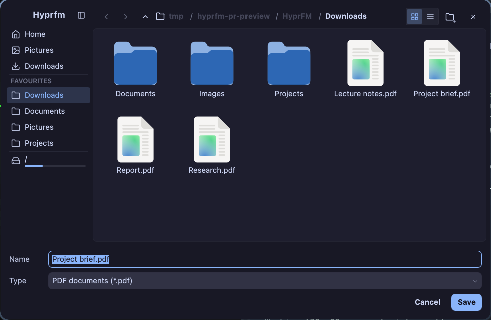
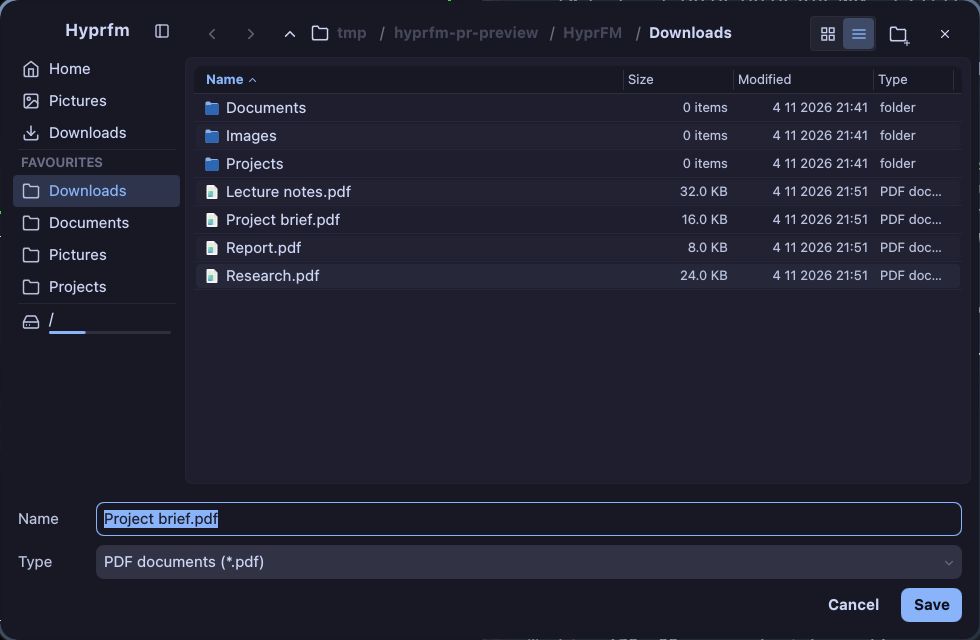

# HyprFM file chooser

HyprFM can serve portal file dialogs using its own QML file views, sidebar,
breadcrumb navigation, icons and configured theme. It does not embed a GTK or
KDE file dialog. The browser/application still performs the actual file I/O.





Screenshots show the real 980×640 chooser with sample files and an isolated
configuration (the grid screenshot uses `grid_fixed_columns = true`). Both
views use the existing HyprFM components.

Build and install for the current user:

```sh
cmake --build build --target hyprfm xdg-desktop-portal-hyprfm
python3 scripts/install-filepicker.py
systemctl --user daemon-reload
systemctl --user restart xdg-desktop-portal-hyprfm xdg-desktop-portal
```

For a packaged/system installation, CMake also installs the `.portal` descriptor,
D-Bus activation file and systemd user unit. Select the backend explicitly in
`~/.config/xdg-desktop-portal/portals.conf`:

```ini
[preferred]
# Keep the other existing portal preferences.
org.freedesktop.impl.portal.FileChooser=hyprfm;gtk
```

The installer backs up existing executables and configuration under
`~/.local/state/hyprfm/filepicker-backups/`. It changes only the FileChooser
preference; screen sharing and screenshot routing stay with their existing
providers. Applications which cache portal availability may need restarting.
Applications with their own chooser must be configured to use desktop portals.

The small Qt/D-Bus backend implements `OpenFile`, `SaveFile`, `SaveFiles` and
request cancellation. Each request launches an independent
`hyprfm --file-picker request.json` process. It never joins the normal file
manager instance or saves over its session. The private request directory is
removed when the interaction finishes. Results return as JSON on stdout;
closing the window returns cancellation. File system writes remain the caller's
responsibility, apart from explicitly creating a new folder in the chooser.

Supported: local files and folders (including local mount points), single and
multiple selection, glob/MIME filters, suggested folder/name/file, additional
checkbox/combo options, overwrite confirmation and unique names for SaveFiles.
The chooser rejects virtual/network URIs that cannot be returned as local files.
The chooser is a resizable 980×640 dialog (minimum 620×400), using HyprFM's
existing toolbar, sidebar, file views and Quill controls. It follows the
configured theme, typography and sidebar side. Split view, tabs and file-manager
settings are hidden in chooser mode. New strings use `qsTr` / `tr`, following
the application's English source strings.

When KF6WindowSystem is available (already an optional HyprFM dependency), the
chooser imports the portal's Wayland/X11 parent before mapping the window.
This lets the compositor place and stack it as a dialog of the requesting app.
Without it, the chooser still opens as a standalone Qt dialog. On Hyprland,
standalone dialogs advertise a fixed initial size until they receive focus;
this makes initial placement floating while retaining normal resizing.

Checks:

```sh
QT_QPA_PLATFORM=offscreen QT_QUICK_BACKEND=software build/tests/tst_mainwindow \
  testFilePickerSaveAndOverwrite testFilePickerFiltersSelectionAndFolders \
  testFilePickerCompactLayoutAndControls
dbus-run-session -- /usr/bin/python3 tests/tst_filepicker_portal.py \
  build/src/xdg-desktop-portal-hyprfm
# Optional: real compositor placement and resizing (skips without Hyprland).
python3 tests/tst_filepicker_window.py build/src/hyprfm
```

The second check uses PyGObject and an isolated session bus, plus a mock picker
process to verify D-Bus serialization, results, errors and cancellation. It does
not change desktop services. UI checks use the real HyprFM QML components and
verify that choosing a path leaves existing contents untouched.

To switch back, restore the previous `portals.conf` from the backup (or remove
its FileChooser preference) and restart `xdg-desktop-portal`. Restore the backed
up `~/.local/bin/hyprfm` if the earlier local executable is also wanted.

Protocol reference:
https://flatpak.github.io/xdg-desktop-portal/docs/doc-org.freedesktop.impl.portal.FileChooser.html
